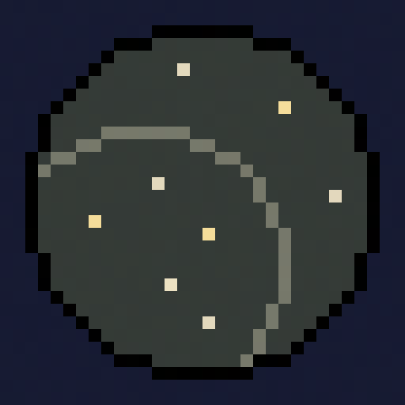

<p align="center"></p>

# Cheonsang

A Fabric mod for Minecraft 26.3 that replaces the overworld sky with the real celestial sphere for any date and any place on Earth.

## Features
- Positions of stars, Sun, Moon, planets and moons computed for the observer's date and location. Planets use a truncated VSOP87 theory (1,259 terms); the maximum difference from PyEphem for 1800–2050 is 2.4″ (Neptune) to 12.6″ (Mars).
- Stars: HYG to magnitude 9, Tycho-2 to 13, and with the optional extra pack 32,061,510 Gaia DR3 stars to magnitude 15.2
- Telescope with real optics: aperture 50–305 mm, eyepieces 40–3 mm, limiting magnitude, diffraction, exit pupil
- Galaxies, nebulae and globular clusters drawn as seen in an eyepiece, based on Digitized Sky Survey plates
- Sky brightness model: twilight, moonlight, airglow, light pollution, dark adaptation, extinction and refraction
- Solar and lunar eclipses for the observer's place, meteor showers, aurora, zodiacal light
- Western 88 constellations or the Korean Cheonsang Yeolcha Bunyajido (289 asterisms)
- `/cfind` to find any object, `/cwhen` for when and where objects and events are visible, `/cplace` for a personal observing location
- Screen day and night follow the real Sun altitude; mob spawning and sleeping stay vanilla
- English and Korean in game

## Documentation
See [docs/](docs/README.md): user manual, overview, technical specification and implementation analysis. Change history: [CHANGELOG.md](CHANGELOG.md).

## Download
See [Releases](../../releases).
- `cheonsang-2.0.0.jar`: the mod (required on client and server)
- `cheonsang-extra-1.0.1.jar`: optional pack with Gaia stars to magnitude 15.2, Milky Way 16K/32K and an 8K Moon map (about 434 MB)

## Requirements
Minecraft 26.3, Fabric Loader 0.20.1 or later, Fabric API, Fabric Language Kotlin, Java 25.
On servers, install the mod on both the server and the clients.

## Building
```
./gradlew build
```
The jar is written to `build/libs/`. The repository contains the mod source and bundled data; the optional extra pack is distributed only as a release file.

## Known limitations
- Not compatible with Iris shaders
- `/cwhen` visibility uses altitude, darkness and moonlight only (no light pollution or weather)
- Stars use J2000 positions with precession only (no nutation, aberration or proper motion); the difference from Stellarium is about 1′
- Meteors follow the computer clock, so multiplayer players see the same meteors only as closely as their clocks agree

## Development
Planning, data selection, design decisions and in-game verification by itsnotfineart. The source code was written in collaboration with a generative AI (Anthropic Claude).

## License
Source code: MIT (see `LICENSE`). Original textures and icons by itsnotfineart: CC BY-SA 4.0.
Data files keep the licenses of their sources (see `CREDITS.txt`). The deep-sky sketch atlas is derived from the Digitized Sky Surveys and is CC BY-NC-SA 4.0 (non-commercial).
